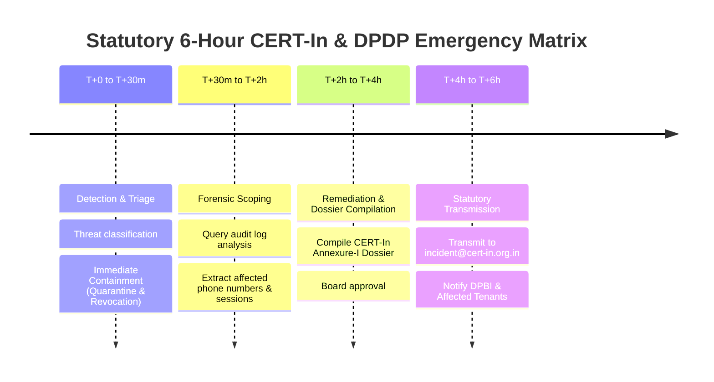

# DATA BREACH FORENSIC PLAYBOOK & 6-HOUR EMERGENCY MATRIX
**Statutory Alignment:** Section 70B(6) Information Technology Act, 2000 (CERT-In Directives) & Section 8(6) Digital Personal Data Protection Act, 2023 (DPDP Board Mandate)  
**Classification:** Confidential — Operational Security Protocol  
**Lead Authority:** QRDine Chief Information Security Officer (CISO) & Data Protection Officer (DPO)

---

## 1. Objective and Activation Criteria

This Playbook defines the mandatory emergency containment and statutory reporting actions executed upon confirmation or reasonable suspicion of a cybersecurity breach or personal data compromise within the QRDine platform.

### Activation Triggers:
- Unauthorized exfiltration or disclosure of diner personal data (phone numbers, order history).
- Compromise of restaurant admin credentials or platform root API tokens.
- Cross-tenant data leakage or multi-tenant database isolation failure.
- Active ransomware, malware deployment, or database manipulation.
- Critical tripwire alerts: Mass token extraction, anomalous bulk export queries, or distributed credential stuffing.

---

## 2. 6-Hour Emergency Response Timeline (T+0 to T+6 Hours)



---

### Phase 1: T+0 to T+30 Minutes — Detection, Triage & Immediate Containment

1. **Severity Classification:**
   - **SEV-1 (Critical):** Confirmed compromise of customer PII, cross-tenant leak, or master secret compromise.
   - **SEV-2 (High):** Localized tenant compromise (single restaurant staff account hijacked).
2. **Execute Automated Containment (`breachForensicService.js`):**
   - **Revoke Active Dining Sessions:** Invalidate all active guest session tokens (`DiningSession.status = 'expired'`).
   - **Quarantine Compromised Tenant:** Set `Cafe.isQuarantined = true` with reason logged to immediately suspend customer-facing menu and ordering endpoints.
   - **Rotate Secrets:** Immediately cycle JWT signing keys and cloud database credentials.

```bash
# Emergency containment via API (authorized role: owner / platform admin)
curl -X POST https://api.qrdine.in/api/incidents/:incidentId/containment \
  -H "Authorization: Bearer $SUPERADMIN_TOKEN" \
  -H "Content-Type: application/json" \
  -d '{"action": "all", "cafeId": "60d0fe4f5311236168a109ca"}'
```

---

### Phase 2: T+30 Minutes to T+2 Hours — Forensic Investigation & Blast Radius Scoping

1. **Freeze System State:** Capture ephemeral container memory dumps and database replica snapshots for forensic preservation.
2. **Query Log Auditing:**
   - Query `AuditLog` collection for unauthorized reads, bulk exports, or privilege elevation.
   - Filter inbound IP addresses from reverse proxy logs (Nginx/Cloudflare) against known threat intelligence feeds.
3. **Determine Impact Scope (`breachForensicService.assessBreachScope`):**
   - Calculate exact count of affected dining sessions.
   - Count affected customer phone numbers.
   - Identify whether payment transaction IDs were accessed.

---

### Phase 3: T+2 Hours to T+4 Hours — Remediation & Dossier Compilation

1. **System Hardening:** Patch exploited vulnerabilities, deploy WAF rules, and verify database integrity.
2. **Compile CERT-In Annexure-I Incident Dossier:**
   - Execute `GET /api/incidents/:incidentId/certin-dossier`.
   - The automated response compiles the exact government-prescribed format:
     - Reporting Organization: QRDine SaaS Platform
     - Date & Time of Incident Detection (in IST)
     - Type of Incident (Data breach / Unauthorized access)
     - IP Addresses, domain names, and technical indicators of compromise (IOCs)
     - Description of Affected Systems & Data Principals
     - Action Taken to Contain the Incident

---

### Phase 4: T+4 Hours to T+6 Hours — Statutory Transmissions & Notifications

1. **CERT-In Formal Notification:**
   - Email compiled dossier to `incident@cert-in.org.in` from authorized security mailbox `security@qrdine.in`.
   - In case of critical infrastructure impact, call CERT-In 24/7 incident hotline: `1800-11-4949`.
2. **Data Protection Board of India (DPBI) Notice:**
   - File official breach notice under Section 8(6) of the DPDP Act 2023 via the designated DPBI portal.
3. **Tenant & Data Fiduciary Communication:**
   - Transmit incident summary and recommended mitigation advice to the authorized restaurant owner contact via encrypted email and SMS broadcast.

---

## 3. Incident Severity and Escalation Matrix

| Severity Level | Impact Definition | Response Lead | Target Containment | External Notice |
| :--- | :--- | :--- | :--- | :--- |
| **SEV-1 (Critical)** | Multi-tenant PII leak or core database breach | CISO & CTO | < 15 Minutes | CERT-In & DPBI within 6 hrs |
| **SEV-2 (High)** | Single-tenant credential compromise | Lead SecOps Engineer | < 30 Minutes | Affected Tenant within 2 hrs |
| **SEV-3 (Medium)** | Isolated API rate limit abuse / failed brute force | Senior DevOps | < 2 Hours | Internal Incident Ticket |

---

## 4. Post-Incident Review & Forensic Evidence Preservation

- All forensic artifacts, log dumps, and incident response comms must be preserved for **not less than three (3) years** under secure, write-once storage.
- Conduct a blameless post-mortem within 72 hours of complete containment and publish a Root Cause Analysis (RCA) to affected stakeholders.
