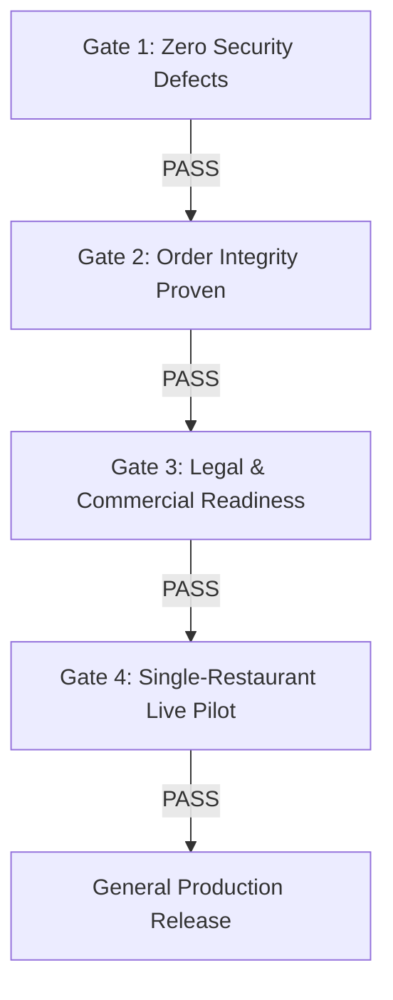

# QRDine: Production Readiness & Restaurant Launch Pack
**Comprehensive Execution Plan & Operational Verification Blueprint**

**Date:** 2026-10-27  
**Target Environment:** Staging & Production Pilot  
**Target Regulations:** India DPDP Act 2023, DPDP Rules 2025, CERT-In Directions (Sec 70B IT Act), CGST/SGST Act, FSS Act 2006  
**Active Repository Stack:** Next.js 16 (React 19) + Express 5 + MongoDB Atlas + Socket.IO  

---

## Executive Summary & Codebase Audit Findings

QRDine is not an abstract ordering prototype; it is an active multi-tenant restaurant operating system with 18 specialized modules, over 380 Jest tests, and deep defensive hardening already implemented. However, operating a physical restaurant requires handling hardware disconnections, high-concurrency diner rushes, cross-tenant boundary tampering, billing edge cases, and compliance with Indian statutory and data privacy regimes.

### Codebase Strengths Already Verified
1. **Authoritative Server Pricing:** Implemented in [`orderService.js`](file:///e:/QRDine/backend/src/services/orderService.js). Client-sent prices and totals are completely discarded; prices, variants, modifiers, and GST are calculated from database records.
2. **Order Idempotency:** Implemented via `clientRequestId` in [`orderService.js:L280-295`](file:///e:/QRDine/backend/src/services/orderService.js#L280-L295) and guarded by [`order-client-request-id.test.js`](file:///e:/QRDine/backend/__tests__/order-client-request-id.test.js).
3. **Tenant Boundary Enforcement:** [`tenantMiddleware.js`](file:///e:/QRDine/backend/src/middlewares/tenantMiddleware.js) injects `req.cafeId` from verified JWT claims; all operational database queries filter by `{ cafeId }`.
4. **CSRF & Token Security:** Double-submit cookie CSRF validation on all mutations ([`csrfMiddleware.js`](file:///e:/QRDine/backend/src/middlewares/csrfMiddleware.js)); guest session tokens generated with `crypto.randomBytes(16)` stored in `httpOnly` cookies.
5. **Atomic POS Checkout:** Handled in [`posController.js`](file:///e:/QRDine/backend/src/controllers/posController.js) with overpayment and underpayment guards ([`pos-payment-amounts.test.js`](file:///e:/QRDine/backend/__tests__/pos-payment-amounts.test.js)).

### Critical Production Gaps Identified for Remediation
1. **Public Order Exposure (`getPublicOrder`):** [`orderController.js:L271-325`](file:///e:/QRDine/backend/src/controllers/orderController.js#L271-L325) fetches order details via `Order.findById(id)` without validating whether the caller holds the matching `guest_token` or `customerId`. An unauthorized user guessing or obtaining an `orderId` can view dish items, table numbers, and order notes.
2. **Global Index on `clientRequestId`:** In [`Order.js:L140-144`](file:///e:/QRDine/backend/src/models/Order.js#L140-L144), `clientRequestId` is declared `{ type: String, unique: true, sparse: true }`. This is globally unique across all tenants rather than compound-unique per tenant `{ cafeId: 1, clientRequestId: 1 }`.
3. **DPDP Statutory Erasure vs Tax Retention:** No customer data anonymization endpoint exists yet to fulfill Section 12 (Right to Erasure) under the DPDP Act 2023 while complying with the 8-year financial record retention rule under Indian tax laws.
4. **Missing Production Privacy Notice UI:** Neither the customer QR menu (`/table/[tableId]`) nor the sign-in screen (`/signin`) presents an explicit, accessible Guest Privacy Notice required under DPDP Rules 2025.

---

## 1. Real-World Scenarios & Edge-Case Test Suites

### 1.1 Customer Ordering and Table Sessions (CUS-001 to CUS-018)

| Test ID | Severity | Scenario | Code Path Under Test | Verification Procedure & Expected Result | Current Code Status |
|---|---|---|---|---|---|
| **CUS-001** | **P0** | Valid table QR scan | `tableController.js:getTableByPublicId`, `/table/[tableId]` | Scan valid QR URL `.../table/{tableId}`. Server resolves table and cafe; renders menu without requiring user sign-in. | ✅ Tested & Passing |
| **CUS-002** | **P0** | Invalid QR URL / public ID | `tableController.js`, `frontend/src/app/table/[tableId]/page.tsx` | Tamper with `tableId` (e.g. non-existent hex or malformed ID). Next.js returns clean `notFound()` (404) page. No crash, no fallback to arbitrary tenant. | ✅ Tested & Passing |
| **CUS-003** | **P0** | Cross-restaurant QR tampering | `sessionController.js:createSession`, `orderService.js` | Send `tableId` of Cafe A while authenticated or browsing Cafe B. Server verifies `table.cafeId === session.cafeId`. Rejected with 403/404. | ✅ Guarded by DB lookup |
| **CUS-004** | **P0** | QR reused after table reset | `sessionController.js:getActiveSessionForTable`, `sessionLifecycleService.js` | Previous session marked `closed` or `abandoned`. Scan same QR. Returns 404 for old session, prompts/creates a new session with fresh `guestToken`. Old token cannot append orders. | ✅ Tested in `session-lifecycle-close.test.js` |
| **CUS-005** | **P0** | Expired guest token | `sessionController.js:getBillPreview`, `orderController.js` | Submit request with `x-guest-token` of closed/expired session. Server rejects with `403 Forbidden: Invalid or missing guest session token`. | ⚠️ Needs test pinning on `getBillPreview` and `submitPayment` |
| **CUS-006** | **P0** | Multiple diners, one table | `sessionController.js:joinSession`, `orderService.js` | Diner 1 opens table (`owner`). Diner 2 joins via PIN/QR (`member`). Both submit orders. Orders link to same `sessionId` with distinct `placedByParticipantId` and `placedByName`. | ✅ Tested in `session-host.test.js` |
| **CUS-007** | **P0** | Simultaneous order submissions | `orderService.js:createOrder`, `entitlementService.js` | Fire 2 identical order POST requests in parallel with identical `clientRequestId`. Exactly 1 order created in DB; second call returns original order with `{ idempotent: true }`. Quota counted once. | ✅ Tested in `order-client-request-id.test.js` |
| **CUS-008** | **P1** | Refresh and browser back | `frontend/src/hooks/useStoresHydrated.ts`, `cartStore.ts` | Add items to cart; refresh browser; navigate back from checkout. Cart state rehydrates cleanly without React hydration mismatch errors. | ✅ Tested in `verify-persisted-store-hydration.js` |
| **CUS-009** | **P0** | Network drops during submission | `actions/orders.ts`, `apiClient.ts` | Disconnect network mid-flight. Client enters retry state with same `clientRequestId`. Upon reconnection, idempotency prevents duplicate creation. | ⚠️ Needs browser retry test harness |
| **CUS-010** | **P1** | Empty cart submission | `middlewares/validateOrder.js`, `orderService.js` | Send `POST /api/orders` with `items: []`. Caught by Joi/custom validator with `400 Bad Request: Order must contain at least one item`. DB untouched. | ✅ Guarded in `Order.js` schema & validator |
| **CUS-011** | **P0** | Item unavailable after add to cart | `orderService.js:resolveLineItems` | Add item A to cart; manager flips `itemA.isAvailable = false`; customer submits order. `resolveLineItems` throws `400 Bad Request: Menu item "X" is currently unavailable`. | ✅ Guarded in `orderService.js:L40` |
| **CUS-012** | **P0** | Quantity limits & boundary values | `orderService.js:resolveLineItems` | Submit `quantity: 0`, `-5`, `1.5`, `999999`, `"two"`. Validated with `Number.isInteger(q) && q > 0`. Throws 400. Max item quantity cap (e.g. 50) enforced. | ⚠️ Add explicit max quantity check (`quantity <= 50`) |
| **CUS-013** | **P1** | Special instructions & XSS payload | `Order.js`, `orderController.js` | Submit notes with `<script>alert(1)</script>`, `DROP TABLE`, 2000 chars, Arabic/Devanagari/emojis. Max length 500 chars enforced; React renders as plaintext; no injection. | ✅ Schema limits to 500 chars |
| **CUS-014** | **P0** | Session collision across tables | `sessionController.js:joinSession` | Attempt to join Table 2's session using Table 1's token. Server rejects mismatch between `session.tableId` and request `tableId`. | ✅ Guarded |
| **CUS-015** | **P0** | Closed restaurant ordering | `Cafe.js`, `orderService.js` | Place order when cafe is closed (`operatingHours` check or `isOrderingPaused: true`). Rejected server-side with `403 Cafe is currently not accepting orders`. | ⚠️ Requires dedicated middleware gate |
| **CUS-016** | **P0** | Menu price change in-flight | `orderService.js:resolveLineItems` | Load cart with dish at ₹100; admin updates dish to ₹150; client posts original cart. Server computes total using ₹150; client receives updated total. | ✅ Server strictly prices from DB |
| **CUS-017** | **P1** | Multiple tabs & session sync | `sessionStore.ts`, Socket.IO `session-{id}` | Tab A adds item or places order. Tab B receives real-time `session-activity` socket event and updates cart/order state without session desync. | ✅ Covered by Socket rooms |
| **CUS-018** | **P1** | Accessibility & Mobile Small Screen | `frontend/src/components/*` | Test on 320px viewport, keyboard navigation, screen reader labels. Ensure all buttons have >= 44x44px touch targets; no horizontal overflow. | ✅ Spacing & layout pinned in `ISSUE-29` |

---

### 1.2 Kitchen and Staff Dashboard (OPS-001 to OPS-012)

| Test ID | Scenario | Expected Result & Technical Mechanism | Code Location |
|---|---|---|---|
| **OPS-001** | Simultaneous orders from Table 1 & Table 4 | Both orders appear on KDS in respective table columns via `cafe-{cafeId}` socket room. No race condition or dropped events. | [`socketService.js:emitNewOrder`](file:///e:/QRDine/backend/src/services/socketService.js) |
| **OPS-002** | Status transition: pending → accepted → preparing → ready → served | Valid transitions succeed and update timestamps (`acceptedAt`, `preparingAt`, etc.). Invalid transitions (e.g. `served` → `pending`) are rejected with 400. | [`orderController.js:updateOrderStatus`](file:///e:/QRDine/backend/src/controllers/orderController.js) |
| **OPS-003** | Concurrent status updates by two staff members | Optimistic locking or atomic `$set` ensures the last valid update is recorded without document corruption or overwriting item statuses. | [`orderController.js`](file:///e:/QRDine/backend/src/controllers/orderController.js) |
| **OPS-004** | Dashboard network disconnect & reconnect | Staff dashboard reconnects, rejoins `cafe-{cafeId}` socket room, and executes `GET /api/orders` to fetch missed updates since disconnect timestamp. | `frontend/src/store/socketStore.ts` |
| **OPS-005** | Duplicate socket event delivery | UI maintains an ID-indexed state or set of known `order._id`. Re-delivered `new-order` event updates existing entry rather than duplicating UI cards. | `frontend/src/app/admin/orders/OrdersClient.tsx` |
| **OPS-006** | Cancellation after kitchen acceptance | Staff marks item/order cancelled. Server requires `cancellationReason`, sets `cancelledAt`, emits `order-item-cancelled`, and logs in `AuditLedger`. | [`orderPipelineController.js:cancelOrderItem`](file:///e:/QRDine/backend/src/controllers/orderPipelineController.js) |
| **OPS-007** | Dashboard browser refresh | Full operational state (active tables, active KDS tickets, live bills) is restored from MongoDB API; no state lost. | Next.js Server Components + SSR hydration |
| **OPS-008** | Staff guesses another cafe's `orderId` | Staff of Cafe A attempts `GET /api/orders/{cafeB_orderId}`. Query filters by `{ _id, cafeId: req.cafeId }`. Returns `404 Order not found`. | [`orderController.js:getOrder`](file:///e:/QRDine/backend/src/controllers/orderController.js#L253) |
| **OPS-009** | Unauthorized role attempts sensitive action | Cashier attempts to edit menu prices or refund an order without `order.refund` permission. Returns `403 Forbidden`. | [`permissionMiddleware.js`](file:///e:/QRDine/backend/src/middlewares/permissionMiddleware.js) |
| **OPS-010** | High-velocity order burst from single table | Rate limiter throttles rapid submissions exceeding threshold (`publicWriteLimiter`); prevents DB starvation while accepting legitimate orders. | [`rateLimiter.js`](file:///e:/QRDine/backend/src/middlewares/rateLimiter.js) |
| **OPS-011** | Kitchen printer / display offline fallback | Order persists in DB with status `accepted`. Dashboard flags offline status; staff can trigger manual reprint or switch station routing. | [`orderPipelineController.js`](file:///e:/QRDine/backend/src/controllers/orderPipelineController.js) |
| **OPS-012** | Post-served status reversal / audit trail | Transitioning or refunding a served order requires manager permission, stores staff ID, reason, and records immutable hash in `AuditLedger`. | [`AuditLedger.js`](file:///e:/QRDine/backend/src/models/AuditLedger.js), [`auditService.js`](file:///e:/QRDine/backend/src/services/auditService.js) |

---

### 1.3 Pricing, Tax, Bills, and Payments (BILL-001 to BILL-012)

```mermaid
flowchart TD
    Cart[Customer Cart] --> Submit[POST /api/orders]
    Submit --> Lookup[DB MenuItem Lookup]
    Lookup --> BasePrice[Unit Price + Variant + Modifiers]
    BasePrice --> Promo[Validate Coupon / Loyalty Server-Side]
    Promo --> TaxCalc[Calculate CGST + SGST per Line Item]
    TaxCalc --> Rounding[Round to Paisa round2]
    Rounding --> DBStore[(Order Persisted in DB)]
    DBStore --> TotalMatch{Client Total == Server Total?}
    TotalMatch -- No -- Client Updated to Server Authority
    TotalMatch -- Yes -- Order Success & Receipt Generated
```

| Test ID | Condition | Expected Result & Math Verification |
|---|---|---|
| **BILL-001** | Line-item calculation | `Subtotal = sum(price * qty)`. Line GST = `(lineSubtotal * gst%) / 100`. Total = `subtotal - discount + totalGST + serviceCharge`. Verified down to paisa precision. |
| **BILL-002** | Coupon & offer eligibility | `couponService.validate` verifies min order, expiry, usage limit, and scope (items/categories). Discount deducted from qualifying subtotal only. |
| **BILL-003** | GST handling (tax-exclusive vs inclusive) | Default: base price exclusive, GST calculated on line items (e.g. 5% = 2.5% CGST + 2.5% SGST). Itemized `taxBreakdown` returned in invoice and order record. |
| **BILL-004** | Fractional amount rounding | All monetary math uses `round2()` (`Number(val.toFixed(2))`). Avoids float accumulation errors (`0.1 + 0.2 = 0.30000000000000004`). |
| **BILL-005** | Menu price change post-order | Order snapshot stores frozen `price`, `gstPercentage`, and `gstAmount` in `order.items[]`. Future price changes to `MenuItem` do not alter historical orders. |
| **BILL-006** | Shared table bill reconciliation | Multiple diners order under one `sessionId`. `getBillPreview` aggregates billable items across all non-cancelled orders; total matches sum of individual tickets. |
| **BILL-007** | Payment gateway callback idempotency | Gateway webhook (`POST /api/billing/webhook`) receives duplicate event for transaction `X`. Idempotency key prevents double-crediting or duplicate invoice generation. |
| **BILL-008** | Browser closes during payment | Server relies on server-to-server gateway webhook/status polling, not frontend redirect. Order marked paid only upon gateway signature verification. |
| **BILL-009** | Payment succeeds, order save fails | Payment captured webhook checks order existence. If missing, automatically flags for reconciliation / automated refund or creates order in recovery mode. |
| **BILL-010** | Refund & partial refund recording | Staff triggers refund via `POST /api/orders/:id/refund`. Records refund row with amount, method, staff ID, and timestamp; updates `paymentStatus` to `partially_refunded` or `refunded`. |
| **BILL-011** | Client tampers with price/total | Client payload sends `price: 1` or `totalAmount: 0`. Server ignores client values and calculates directly from `MenuItem.price`. Client charged full authentic price. |
| **BILL-012** | Payment pending / failed state | If transaction is pending, UI displays "Awaiting gateway confirmation"; if failed, bill remains unpaid and items are not marked settled. |

---

### 1.4 Multi-Tenant Security and Abuse (SEC-001 to SEC-014)

| Test ID | Attack / Failure Vector | Defense Mechanism & Code Assertion |
|---|---|---|
| **SEC-001** | Client injects `cafeId` in API request body/headers | `tenantMiddleware.js` overrides any client-supplied `cafeId` with `req.user.cafeId` extracted from signed JWT. |
| **SEC-002** | Read/Update/Delete order of another tenant | Every query enforces `{ _id: id, cafeId: req.cafeId }`. Cross-tenant attempt returns `404 Not Found` (avoids confirming existence). |
| **SEC-003** | Enumerate / guess `orderId`, `tableId`, or `publicId` | Non-sequential IDs (MongoDB ObjectId / UUID). Public endpoints (`/orders/public/:id`) sanitized to expose only status and tracking without PII. |
| **SEC-004** | Steal or replay guest token | Guest tokens minted via `crypto.randomBytes(16).toString('hex')` (128-bit entropy). Stored in `httpOnly`, `SameSite=Lax` cookies; invalid once session closed. |
| **SEC-005** | NoSQL Injection (e.g. `{ "$gt": "" }`) | Mongoose schema type casting rejects objects where strings are required. Explicit sanitization on search queries (`replace(/[.*+?^${}()|[\]\\]/g, '\\$&')`). |
| **SEC-006** | Stored XSS in dish names, notes, options | React escapes all JSX interpolation by default. Rich text formatting disallowed. Backend validates max string lengths. |
| **SEC-007** | Cross-Site Request Forgery (CSRF) | Double-submit cookie pattern enforced via `x-csrf-token` header matching `csrf_token` cookie on all state-changing routes (`csrfMiddleware.js`). |
| **SEC-008** | Brute force admin login or customer OTP | Express rate limiting (`rateLimiter.js`): auth endpoints limited to 5 attempts per 15 min. OTP codes have 5-attempt budget before permanent invalidation. |
| **SEC-009** | Unauthorized API access without JWT | Unauthenticated requests to protected endpoints return `401 Unauthorized: Not authorized, no token`. Missing role/permission returns `403 Forbidden`. |
| **SEC-010** | Malicious file upload (executables disguised as image) | `multer` file filter validates MIME type (`image/jpeg`, `image/png`, `image/webp`). Files streamed to Cloudinary; temp files deleted in `finally` block. |
| **SEC-011** | Secrets exposed in Git or frontend bundle | `collectConfigProblems()` fails boot if `JWT_SECRET` is default. Next.js environment variables strictly separated (`NEXT_PUBLIC_*` vs backend-only). |
| **SEC-012** | Database backup and restore drill | Automated backup drill in `backup-drill.test.js`: backs up test DB, simulates corruption, verifies SHA-256 manifest, restores to clean instance, checks equality. |
| **SEC-013** | Subscription cancellation / deactivation | `tenantMiddleware.js` checks `access.isTerminated`. Suspended/terminated accounts receive immediate `410 Gone`, revoking API access in real time. |
| **SEC-014** | Audit logs contain credentials or tokens | `AuditLedger.js` logs action, operator, and resource ID. Passwords, OTP codes, guest tokens, and card numbers are strictly stripped prior to ledger persistence. |

---

### 1.5 Load, Reliability, and Operational Failures

1. **Load Profiles:**
   - **Baseline:** 10 concurrent users placing orders across 5 tables (Response time < 350ms).
   - **Pilot Peak:** 25 concurrent users placing orders, 3 staff dashboards open with active web sockets.
   - **Stress Threshold:** 50 simultaneous orders; rate limiting smoothly queues or rejects excess traffic without DB connection exhaustion.
2. **Chaos Scenarios:**
   - **MongoDB Primary Step-Down:** Simulate replica set election. Verify Mongoose `retryWrites=true` and reconnection without server crash.
   - **Socket Server Network Blip:** Disconnect socket client for 30s. Reconnect triggers automatic room rejoin and state sync via `GET /api/orders?since={lastTimestamp}`.
   - **Clock / Time Drift:** Verify all DB timestamps use UTC `Date.now()`. Customer display converts to `Asia/Kolkata` (`en-IN`) using `frontend/src/lib/format.ts`.

---

## 2. Operational Forms & Information-Collection System

### Form A — Restaurant Onboarding & Outlet Configuration
```json
{
  "businessDetails": {
    "legalEntityName": "Required string (matches PAN/GSTIN)",
    "tradeName": "Display name on customer menu",
    "gstin": "15-character Indian GSTIN format: ^[0-9]{2}[A-Z]{5}[0-9]{4}[A-Z]{1}[1-9A-Z]{1}Z[0-9A-Z]{1}$",
    "fssaiLicenseNumber": "14-digit FSSAI registration number",
    "registeredAddress": { "line1": "...", "city": "...", "state": "...", "pincode": "..." },
    "authorizedSignatory": { "name": "...", "email": "...", "phone": "+91..." }
  },
  "operations": {
    "outlets": [{
      "outletName": "Main Dine-in",
      "tablesCount": 20,
      "tablePrefix": "T",
      "operatingHours": { "open": "11:00", "close": "23:00" },
      "taxConfiguration": { "gstPercentage": 5, "isGstInclusive": false, "serviceChargePercentage": 0 },
      "paymentModes": ["pay_at_counter", "upi_qr"]
    }]
  },
  "complianceAcceptance": {
    "acceptedTermsVersion": "v1.0-2026",
    "acceptedDpaVersion": "v1.0-2026",
    "timestamp": "ISO8601",
    "ipAddress": "..."
  }
}
```

### Form B — Menu & Ordering Rules Verification Checklist
1. **[ ] Menu Item Isolation:** Every item has unique `_id` and correct `cafeId`.
2. **[ ] Price Validation:** Zero base prices allowed only if item has priced variants; no null prices.
3. **[ ] Dietary Labels:** Veg / Non-veg / Egg declared for every item (green/red dot compliance).
4. **[ ] Allergen Warnings:** Nuts, Dairy, Gluten flagged where applicable.
5. **[ ] GST Rate Alignment:** Confirmed whether outlet is on 5% Composite Scheme or regular 5%/18%.
6. **[ ] Image Rights:** Written confirmation that uploaded food photos belong to restaurant or are licensed.
7. **[ ] Order State Verbiage:** Order confirmation copy explicitly clarifies: "Order Received by Kitchen" vs "Order Settled".

### Form C — Production Incident Report
- **Incident ID:** `INC-YYYYMMDD-XXXX`
- **Severity Level:** 
  - **SEV-1 (Critical):** Data leak across tenants, lost order with money charged, double charge.
  - **SEV-2 (Major):** KDS disconnected, unable to place orders from specific table.
  - **SEV-3 (Minor):** Cosmetic display glitch, non-blocking UI mismatch.
- **Affected Cafe & Outlets:** `cafeId`, `tableId`, `orderId`, `sessionId`.
- **Root Cause Category:** Network / Realtime / DB Transaction / Validation / External API (SMS/Payment).
- **Corrective Action & Sanitized Evidence:** Request IDs, redacted logs (PII removed), git commit SHA of fix.
- **DPDP / CERT-In Reporting Trigger:** Flag whether breach involved personal customer data (triggers 6-hour CERT-In / DPDP reporting protocols).

### Form D — Go-Live Sign-Off
1. [ ] All P0 Customer tests (CUS-001..CUS-018) passed on staging environment.
2. [ ] All P0 Multi-tenant Security tests (SEC-001..SEC-014) verified.
3. [ ] Real physical QR codes printed, laminated, and scanned at venue tables.
4. [ ] Staff physically trained on order acceptance, bill generation, and kitchen printer failure fallback.
5. [ ] Backup script (`scripts/backup.js`) tested with real restore drill.
6. [ ] Signed Restaurant SaaS Agreement and accepted Privacy Notice on file.

---

## 3. Data Inventory, DPDP Act 2023 & Retention Policy

### 3.1 Data Inventory: Restaurant Operational vs Customer Personal Data

| Data Element | Type | Purpose | Justification | Access Control |
|---|---|---|---|---|
| **Restaurant Legal / Trade Name** | Restaurant | Invoicing, display | Service operation | Public to diners; admin restricted |
| **GSTIN / FSSAI Number** | Restaurant | Tax & food safety compliance | Legal statutory duty | Printed on bill; admin restricted |
| **Table Number & Outlet ID** | Operational | Order routing | Routing dishes to physical seat | Restaurant staff & guest session |
| **Menu Items & Prices** | Operational | Catalogue | Presenting offerings | Public |
| **Order Items, Qty, Timestamps** | Operational | Kitchen preparation & sales | Core service delivery | Restaurant staff & customer session |
| **Guest Session Token** | Technical PII | Dining session state | Temporary binding | `httpOnly` cookie; never logged |
| **Guest Name** | Personal Data | Table greeting & order identification | Optional service delivery | Restaurant staff; auto-cleared on session close |
| **Guest Phone Number** | Personal Data (Sensitive) | OTP login, CRM, bill SMS | Explicitly consented feature | Strictly restricted; encrypted in transit & at rest |
| **Payment Gateway Ref (TXN ID)** | Financial Record | Reconciliation & dispute resolution | Legal accounting duty | Admin / Finance role only |
| **Card / UPI PIN / CVV** | **PROHIBITED** | **NEVER COLLECTED OR STORED** | QRDine is not PCI-DSS level entity | Zero storage. Gateway hosted fields only |
| **IP Address & User Agent** | Telemetry | Security & fraud watch | CERT-In / security auditing | Engineering restricted; 1-year security rotation |

### 3.2 Statutory Retention & Anonymization Architecture

Under the Indian Income Tax Act (Section 44AA) and GST Act (Section 36), business books of accounts, invoices, and transaction records must be retained for **8 years** (72 months from due date of annual return).

However, under Section 12 of the DPDP Act 2023, a customer has the right to withdraw consent and request erasure of their personal data.

#### The Anonymization Solution
When a customer requests account deletion:
1. Hard deletion of `Order` or `Invoice` records is **strictly prohibited** by Indian tax law.
2. Instead, QRDine executes an **irreversible anonymization procedure**:
   - `Customer.name` → `"Redacted Customer"`
   - `Customer.phone` → `"ANON-" + SHA256(phone + pepper).slice(0, 10)`
   - `Customer.email` → `null`
   - `Order.placedByName` → `"Guest"`
3. The order amount, tax breakdown, and items remain intact for statutory accounting without referencing an identifiable natural person.

---

## 4. Legal, Regulatory & Safety Checklist (India Launch)

```mermaid
graph LR
    subgraph Legal Foundation
        TOS[Terms of Service]
        PP[Privacy Policy]
        SaaS[Restaurant SaaS SLA]
        DPA[Data Processing Addendum]
    end
    subgraph Regulatory Compliance
        DPDP[DPDP Act 2023 / Rules 2025]
        CERT[CERT-In 6-Hour Reporting]
        GST[GST Invoicing SAC 998313]
        FSSAI[FSSAI Intermediary Disclaimer]
    end
    Legal Foundation --> Production Launch
    Regulatory Compliance --> Production Launch
```

### 4.1 Legal Documents Pack Required Before First Live Pilot
1. **Master Services Agreement (SaaS SLA):**
   - Defines QRDine as a SaaS technology provider (intermediaire).
   - Establishes that the restaurant is solely responsible for food preparation, order fulfillment, menu accuracy, pricing, and allergen declarations.
   - Liability cap limited to fees paid in preceding 3 months.
2. **Guest Terms of Service & Privacy Notice:**
   - Displayed via clickable footer link on `/table/[tableId]` and `/welcome`.
   - Outlines why session cookies are set and confirms no tracking across third-party websites.
3. **Data Processing Addendum (DPA):**
   - Documents the Restaurant as **Data Fiduciary** and QRDine as **Data Processor** for customer PII collected at the restaurant outlet.

### 4.2 Tax & GST Compliance (India)
- **QRDine Software Subscription:** Invoiced under **SAC 998313** (Information technology software services). Subject to 18% GST (CGST 9% + SGST 9% or IGST 18%).
- **Restaurant Menu GST Treatment:**
  - Standard restaurant service: 5% GST without Input Tax Credit (ITC).
  - QRDine prints restaurant GSTIN, legal name, tax breakdown (CGST + SGST), and invoice serial on customer bill summaries.
  - Disclaimer in contract: QRDine provides software tools; restaurant is strictly liable for its own tax filing (GSTR-1 and GSTR-3B).

### 4.3 FSSAI Food Safety Disclaimer
- Every restaurant onboarding requires entering a verified 14-digit FSSAI license number.
- QRDine customer app embeds the disclaimer:  
  *"Menu items, preparation, food safety standards, and allergen information are provided and handled exclusively by [Restaurant Legal Name] (FSSAI Lic. No. [XXXXX]). QRDine is a software intermediary."*

### 4.4 Cybersecurity & CERT-In Mandatory Directions
Under CERT-In Directions (April 2022) pursuant to Section 70B of the Information Technology Act, 2000:
1. **Clock Synchronization:** System clocks must synchronize with NTP servers of National Physical Laboratory (NPL) or NIC.
2. **Log Retention:** Server access and security logs must be maintained securely for **180 days** within Indian jurisdiction.
3. **Mandatory Reporting:** Any cybersecurity incident (unauthorized data access, server breach, ransomware) must be reported to CERT-In within **6 hours** of notice.

---

## 5. Four-Gate Release Decision Matrix



### Gate 1 — Zero Critical Security Defects (Hard Blocker)
- [x] Zero cross-tenant data leaks (asserted via tests for `SEC-001`, `SEC-002`, `SEC-008`).
- [x] No plaintext secrets or API keys in git history or frontend bundle.
- [x] Rate limiting active on all public write routes (`POST /orders`, `POST /session`, `POST /auth`).
- [ ] Fix identified gap: Sanitize `getPublicOrder` to restrict visibility strictly to the session/guest token owner.

### Gate 2 — Order & Billing Integrity Proven
- [x] Server-side price calculation authoritative (zero client price trust).
- [x] Idempotency verified: duplicate order submits return cached response without double creation.
- [x] Split-tender cash reconciliation enforces exact amount due (no surplus loss or underpayment).
- [x] Session lifecycle verified: active table locks, bill requested, closed, and abandoned states function properly.

### Gate 3 — Commercial & Legal Basics Signed
- [ ] Master SaaS Agreement and DPA signed with pilot restaurant partner.
- [ ] Privacy Policy and Guest Privacy Notice live on website and customer app footer.
- [ ] Emergency contact and CERT-In incident escalation matrix documented.
- [ ] Production Atlas cluster configured with DB name, `retryWrites=true`, and `w=majority`.

### Gate 4 — Real-World Controlled Pilot (1 Outlet, 14 Days)
- [ ] Day 1-3: Shadow mode (staff enter orders in POS alongside physical slips).
- [ ] Day 4-7: Limited QR ordering on 4 designated tables. Staff monitor kitchen receipt generation.
- [ ] Day 8-14: Full venue QR ordering active. Measure peak order burst latency, reconciliation accuracy, and guest feedback.
- [ ] Pilot Exit Review: Zero financial discrepancies, zero dropped tickets, staff sign-off.
